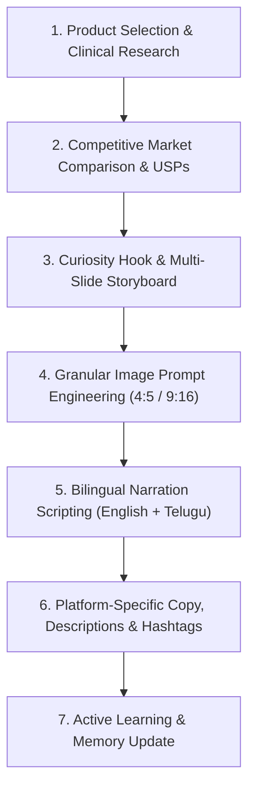

# Social Media Content Engine (N-Square Store)

This skill provides an end-to-end operating procedure for turning any product in the N-Square catalog into high-performing, scientifically truthful social media content across **Instagram, YouTube, and LinkedIn**.

---

## Operating Principles & Strict Truth Mandate

1. **Strictly Truth-Bound**: Never invent claims, cure promises, or unverified medical statements. Base all arguments on official product data, clinical monographs, certified ingredients, and ICMR RDA guidelines.
2. **Curiosity First, Education Second, Promotion Third**:
   - Slide 1 Hook -> Slides 2..N Factual Biology -> Slide N+1 Personal Recommendation -> Slide N+2 Factual Comparison -> Final Slide Trust & CTA.
3. **Dual-Use Visuals (Carousel + Video)**: All image prompts must feature a centered **4:5 vertical focal zone** within a **9:16 canvas**, with clean negative space at top and bottom for typography and platform UI.
4. **Bilingual Video Readiness**: Every post set includes synced voiceover narration in **English** and **natural conversational Telugu (వాడుక భాష)**.
5. **Continuous Learning**: Actively updates its rules in [`resources/learned_patterns.json`](./resources/learned_patterns.json) whenever the user expresses a preference, likes a format, or gives new instructions.

---

## End-to-End Content Creation Workflow

---

## Step 1: Product Selection & Factual Research
1. Identify the target product from the store catalog or user prompt.
2. Consult the [Research Protocol](./references/research-protocol.md) and extract ground truth from `data/official_amway_details.json` and `data/reports_bundle.js`:
   - Exact milligrams per active serving.
   - Farm source (certified organic botanical vs chemical derivative).
   - Bioavailability mechanism (chelation, natural phytonutrient cofactors, enteric coating).
   - Official clinical nutrition rationale and ICMR RDA coverage.
3. Contrast with mass-market generic alternatives (petrochemical synthetics, chalk binders, artificial sweeteners/dyes) without illegal brand defamation.

---

## Step 2: Carousel Storyboard Construction
Follow the [Carousel Storyboard Framework](./references/carousel-storyboard-framework.md) to structure a 5 to 7-slide sequence:

1. **Slide 1 (The Curiosity Hook)**: Must start with one of the approved hook styles:
   - *"Do you know this ?"*
   - *"Don't do this / Don't use this in that way ?"*
   - *"How does it work ?"*
   - *"What is this ?"*
2. **Slides 2 to N (Factual Knowledge)**: 2 to 4 bite-sized slides explaining the biological problem, cellular mechanics, and daily dietary shortfall.
3. **Slide N+1 (Personal Recommendation)**: *"From my side, I would suggest this: [Product Name]"*. Focus on organic traceability and clean label.
4. **Slide N+2 (Honest Market Comparison)**: Side-by-side comparison matrix showing *Common Market Products* vs *Nutrilite (N-Square Store)*.
5. **Final Slide (Call-to-Action & Contact)**: Showcases website (`nsquarestore.com`), WhatsApp contact, and the exact signature line:
   > *"Need more clarification ? connect me ->"*

---

## Step 3: Granular Image Prompt Generation
Follow the [Image Prompt Playbook](./references/image-prompt-playbook.md).
For every slide, deliver:
- **Visual Concept Summary**: What the viewer sees.
- **Exact AI Image Prompt**: Engineered for Flux.1 Schnell / Ideogram / Recraft / Leonardo.
  - Aspect ratio: `--ar 9:16` (with centered 4:5 subject focal zone).
  - Clear negative space at top and bottom.
  - Zero text or watermark keywords in negative prompt.
- **On-Screen Typography Overlay**: Exact text, font weight, and positioning.
- Tool guide reference: Consult [Free AI Tools Guide](./references/free-ai-tools-guide.md).

---

## Step 4: Bilingual Video Narration Scripting (English + Telugu)
Follow the [Bilingual Video Scripting Guide](./references/video-scripting-bilingual.md).
Deliver a synchronized 35 to 55-second vertical video script:
- **English Voiceover**: Modern, crisp, conversational, authoritative.
- **Telugu Voiceover (వాడుక భాష)**: Natural, fluent spoken Telugu as used in modern everyday conversations. Avoid stiff, archaic bookish vocabulary.
- Include visual timing (seconds) and vocal tone cues for each slide.

---

## Step 5: Multi-Platform Post Copy, Titles & Tags
Follow the [Platform Copy Templates](./references/platform-copy-templates.md).
Deliver tailored metadata for all 3 target networks:
- **Instagram**: First 2 lines hook, clean bulleted takeaway, clear CTA, and 25-30 categorized hashtags.
- **YouTube Shorts & Community**: Punchy Shorts title (<60 chars with emojis), description with timestamps and store link, and comma-separated tag list.
- **LinkedIn**: Thought-leadership perspective on preventative wellness, corporate metabolic resilience, clean formatting, and professional hashtags.

---

## Step 6: Active Self-Learning Protocol

> [!IMPORTANT]
> **How this skill learns from the user:**
> 1. Ingest existing preferences from [`resources/learned_patterns.json`](./resources/learned_patterns.json) before crafting any post.
> 2. Whenever the user provides feedback (e.g., *"I loved this hook style"*, *"Keep Telugu sentences shorter"*, *"Add this phone number"*, *"Never use this phrase"*):
>    - Immediately read [`resources/learned_patterns.json`](./resources/learned_patterns.json).
>    - Append the new rule into the `userLearnedRules` array with `id`, `timestamp`, `instruction`, and `applicationRule`.
>    - If the user liked a specific hook or aesthetic, add it to `approvedHooks` or `visualPreferences`.
>    - Write the updated JSON back to [`resources/learned_patterns.json`](./resources/learned_patterns.json).
>    - Confirm the update to the user: *"Learned rule saved: [Brief summary]. This will now be applied automatically to all future posts."*

